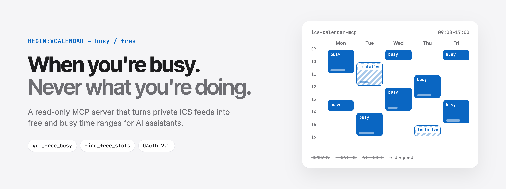
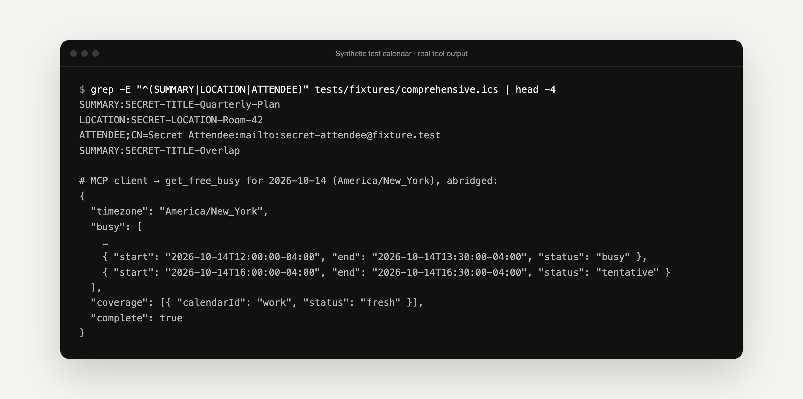

<p align="center">
  <picture>
    <source media="(prefers-color-scheme: dark)" srcset=".github/assets/banner-dark.png">
    
  </picture>
</p>

<p align="center">
  <strong>Your assistant sees when you're busy. Never what you're doing.</strong><br>
  A small, read-only <a href="https://modelcontextprotocol.io">Model Context Protocol</a> server that reads your private ICS calendar feeds and answers just two questions: <em>when am I busy?</em> and <em>when am I free?</em>
</p>

<p align="center">
  <a href="#quick-start"><strong>Quick start</strong></a> ·
  <a href="#the-three-tools"><strong>Tools</strong></a> ·
  <a href="#privacy-by-design"><strong>Privacy</strong></a> ·
  <a href="#deploy-your-own"><strong>Deploy</strong></a> ·
  <a href="CONTRIBUTING.md"><strong>Contribute</strong></a>
</p>

<p align="center">
  <a href="LICENSE"></a>
  
  
  <a href="https://github.com/mihirkavi/ics-calendar-mcp/actions/workflows/ci.yml"></a>
</p>

<p align="center">
  
  <br><sub>The test calendar above is full of fake secrets. The real <code>get_free_busy</code> tool output beneath it contains none of them, only time ranges.</sub>
</p>

## Why ICS Calendar MCP

To plan a meeting, an AI assistant needs to know when you're free. Most calendar integrations hand it far more than that: meeting titles, notes, who you're meeting, where, and often write access too.

**ICS Calendar MCP gives the assistant only time ranges.** It reads the private subscription links that iCloud, Google and most calendar apps can publish, strips every event down to a start and an end, merges your calendars, and returns busy blocks or free slots. Event details and feed URLs never leave the server.

<table>
  <tr>
    <td width="33%" valign="top">
      <h3>Times, not details</h3>
      Titles, notes, attendees, locations and UIDs are dropped before anything else sees them. Tests check that none of them appear in any output or error.
    </td>
    <td width="33%" valign="top">
      <h3>Read-only and yours alone</h3>
      No writes, no CalDAV. Every request needs an OAuth 2.1 token issued to one GitHub account, matched by its permanent numeric ID.
    </td>
    <td width="33%" valign="top">
      <h3>Honest answers</h3>
      If a calendar can't be read, it is reported as <code>unavailable</code> and <code>complete</code> is <code>false</code>. An unreadable calendar is never treated as an empty one.
    </td>
  </tr>
</table>

Ask things like *"Find me a free hour on Thursday afternoon"* or *"Am I free Friday between 2 and 4?"*

## The three tools

All three are read-only.

| Tool | What it returns |
| --- | --- |
| `list_calendars` | Configured calendar IDs, display names and timezones, plus the current time. Never feed URLs or secrets. |
| `get_free_busy` | Merged busy intervals (`busy` or `tentative`) across the chosen calendars for up to 93 days, with per-calendar coverage. |
| `find_free_slots` | Free windows of at least N minutes inside working hours (default 09:00–17:00 on weekdays), with an optional buffer around meetings. |

<details>
<summary><strong>What calendar data it understands</strong></summary>
<br>

- Timed, all-day, multi-day and overnight events
- Recurrence (`RRULE`, `RDATE`, `EXDATE`), modified and cancelled occurrences, and `RANGE=THISANDFUTURE`
- `STATUS:CANCELLED` and `TRANSP:TRANSPARENT` events are skipped; `STATUS:TENTATIVE` events are reported as `tentative`
- IANA timezones, embedded `VTIMEZONE` definitions, floating times (read in the calendar's default timezone) and DST transitions
- Overlapping events from any number of calendars are merged

</details>

## Quick start

You need Node.js 22 or newer (24 recommended; see `.nvmrc`).

```bash
git clone https://github.com/mihirkavi/ics-calendar-mcp.git
cd ics-calendar-mcp
npm install
npm test        # 125 tests in the Workers runtime (Miniflare), no network access
```

`npm run check` type-checks and `npm run lint` runs ESLint. To run the Worker locally, copy `.dev.vars.example` to `.dev.vars`, fill it in and run `npm run dev`. The sign-in cookies need HTTPS, so use `wrangler dev --local-protocol https` or test sign-in against a deployed Worker.

## How it works

```
MCP client ──OAuth 2.1──▶ Cloudflare Worker
                           ├─ OAuth provider (/authorize, /token, /register, discovery)
                           │    └─ GitHub sign-in + numeric-ID allowlist
                           └─ /mcp (stateless Streamable HTTP)
                                └─ CalendarService
                                     ├─ registry (IDs → secret bindings)
                                     ├─ fetch policy (HTTPS, exact host, limits)
                                     ├─ ICS adapter (ICAL.js → detail-free intervals)
                                     └─ interval merge + free-slot search
```

The server stores no event data: each request fetches the feeds live, turns them into bare intervals and throws the rest away.

## Privacy by design

- **No event content.** The ICS adapter reads only start, end, duration, recurrence, status and transparency.
- **Callers can't choose URLs.** Feeds come only from an operator-defined registry and Worker secrets. Each fetch needs HTTPS and an exact hostname, rejects embedded credentials, custom ports and redirects, times out after 10 seconds and stops at 5 MiB.
- **Bounded work.** Ranges are capped at 93 days, 10,000 busy occurrences per calendar and 100,000 recurrence candidates.
- **Locked-down sign-in.** PKCE (S256), exact redirect-URI checks, a consent page that can't be framed, single-use browser-bound state, and tokens stored only as hashes in Cloudflare KV. The GitHub token is discarded after the identity check.
- **Redacted errors.** Public errors carry a stable code and a generic message, with URLs, credentials and calendar text scrubbed.

> **Treat calendar subscription links like passwords.** Anyone with the link can read the full calendar. Keep them in Worker secrets, and regenerate them in your calendar app if they're ever exposed.

## Deploy your own

One Cloudflare Worker (the free plan is enough to try it), a GitHub account and a GitHub OAuth App.

```bash
npx wrangler kv namespace create OAUTH_KV          # put the ID in wrangler.jsonc
npx wrangler secret put GITHUB_CLIENT_ID
npx wrangler secret put GITHUB_CLIENT_SECRET
npx wrangler secret put ALLOWED_GITHUB_USER_ID     # numeric: gh api user --jq .id
npx wrangler secret put CALENDAR_REGISTRY          # JSON array, see below
npx wrangler secret put CALENDAR_1_ICS_URL         # one per calendar
npm run deploy
```

Your MCP endpoint is `https://<your-worker-host>/mcp`. Set the OAuth App's callback URL to `https://<your-worker-host>/callback`.

<details>
<summary><strong>Configuring calendars</strong></summary>
<br>

Without configuration, the server uses one synthetic example calendar (`example-calendar`, read from the `CALENDAR_EXAMPLE_ICS_URL` secret, host `calendar.example.com`). To use your own, set `CALENDAR_REGISTRY` to a JSON array:

```json
[
  {
    "id": "work",
    "name": "Work",
    "enabled": true,
    "timezone": "America/New_York",
    "secretBinding": "CALENDAR_1_ICS_URL",
    "allowedHostname": "calendar.example.com"
  }
]
```

- `id`: lowercase letters, digits and hyphens. MCP clients pass it as `calendarIds`.
- `timezone`: an IANA zone, used for all-day and floating events and as the default output zone.
- `secretBinding`: the name of a separate Worker secret that holds the feed URL.
- `allowedHostname`: the exact host the feed URL must use.

Feed URLs must be `https://`. If your calendar app gives you a `webcal://` link, replace `webcal` with `https`.

</details>

<details>
<summary><strong>Deployment details and keeping IDs out of Git</strong></summary>
<br>

If you don't want the KV namespace ID in Git, copy `wrangler.jsonc` to `wrangler.local.jsonc` (ignored by Git), edit the copy, and pass `-c wrangler.local.jsonc` to Wrangler. `npm run deploy:local` does this for you. Each `secret put` prompts for its value, so secrets never land in your shell history or in files.

OAuth discovery is published at `/.well-known/oauth-protected-resource/mcp` and `/.well-known/oauth-authorization-server`, and clients can register dynamically at `/register`.

</details>

<details>
<summary><strong>Connecting a client</strong></summary>
<br>

- **ChatGPT:** add a custom MCP connector with the `/mcp` URL and OAuth, then sign in with GitHub. Whether custom connectors (and connectors in mobile and Voice modes) are available depends on your plan, workspace settings and OpenAI's rollout.
- **MCP Inspector:** run `npx @modelcontextprotocol/inspector`, choose Streamable HTTP, enter the `/mcp` URL and complete the OAuth flow.
- **Other clients:** any client that supports remote Streamable HTTP servers with OAuth 2.1 discovery and dynamic client registration should work.

</details>

<details>
<summary><strong>Where the code lives</strong></summary>
<br>

| Path | Responsibility |
| --- | --- |
| `src/index.ts` | Worker entry: OAuth provider wiring and the protected `/mcp` handler |
| `src/auth/` | Consent page, GitHub sign-in, numeric-ID allowlist |
| `src/mcp/` | Tool schemas, registration and text summaries |
| `src/calendars/` | Registry, service, ICS adapter, interval math, timezone helpers |
| `src/security/` | Feed fetch policy and error redaction |

</details>

## Honest status

**v0.1 is an early, read-only foundation.** It works end to end and has been verified with a standalone MCP client against one private deployment ([record](docs/verification/chatgpt-plugin-verification.md)), but it hasn't been tested across many calendar providers, and ChatGPT connector use is not yet verified.

- Read-only: no creating, editing or deleting events, and no CalDAV.
- One allowed GitHub account per deployment; no multi-user access.
- Feeds are fetched live on every request with no cache. A slow or offline provider makes that calendar `unavailable` (reported, never silently empty).
- Published ICS feeds can lag behind the calendar app by several minutes.
- Working hours can't cross midnight, and `find_free_slots` returns at most 100 windows.
- A calendar that needs more than 100,000 recurrence candidates, or has more than 10,000 busy occurrences in the range, is reported as `unavailable` for that request.
- Windows-style timezone names such as `Pacific Standard Time` work only when the feed includes their definition.

**Ideas, not commitments (none implemented):** short-lived caching with explicit `stale` coverage, per-calendar working hours, and CalDAV as another source.

## Contributing

See [CONTRIBUTING.md](CONTRIBUTING.md) and the [changelog](CHANGELOG.md). Please report vulnerabilities privately as described in [SECURITY.md](SECURITY.md), not in public issues.

## License

[MIT](LICENSE) © 2026 Mihir Kavishwar

<p align="center">
  <br>
  <sub><strong>ICS Calendar MCP</strong> · Free time, not your private life.</sub>
</p>
